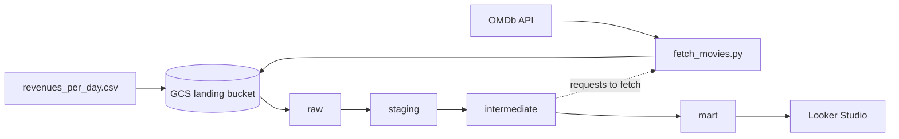

# OMDb Box Office Data Warehouse

Box office Data Warehouse on Google Cloud Platform - daily box office revenues enriched with OMDb metadata.

Source data for the data warehouse comes from:
- CSV file with daily revenues of movie theaters in the US (337 818 rows, 2000-2023)
- movie metadata from the OMDb API

The data warehouse is built as a star schema in BigQuery.
Fact tables: 
- title x day

Dimension tables:
- date
- movie
- distributor

Bridge tables:
- movie x genre

The data is visualized in the ranking dashboard.

[Dashboard in Looker Studio](https://datastudio.google.com/reporting/4260f514-691a-4634-a119-6125234cd412)

Stack: Cloud Storage, BigQuery, Dataform, Terraform, Python (uv), Looker Studio.

## Architecture

## Data model

## How to run