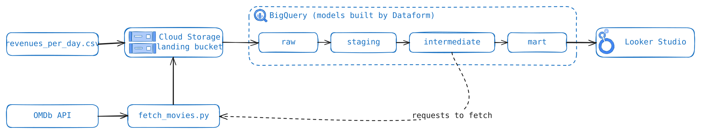
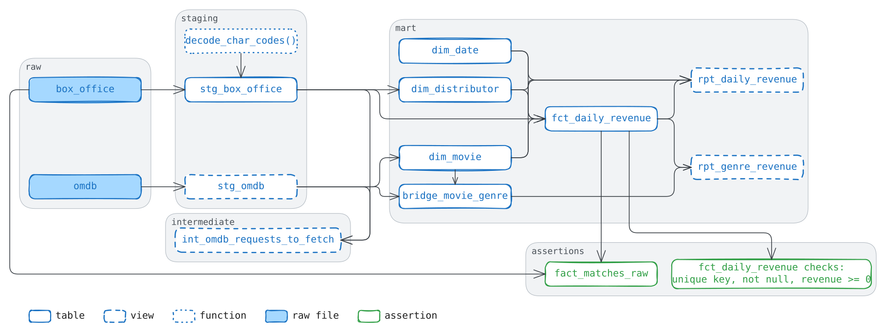
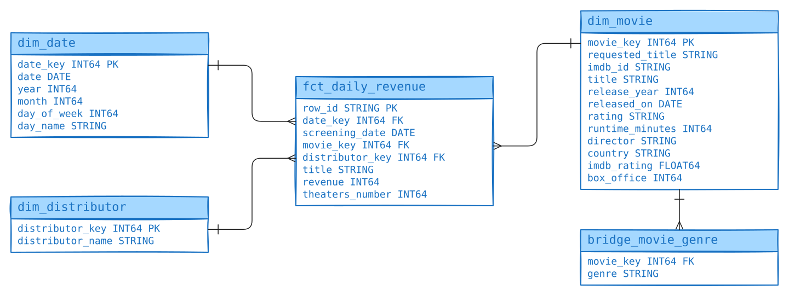
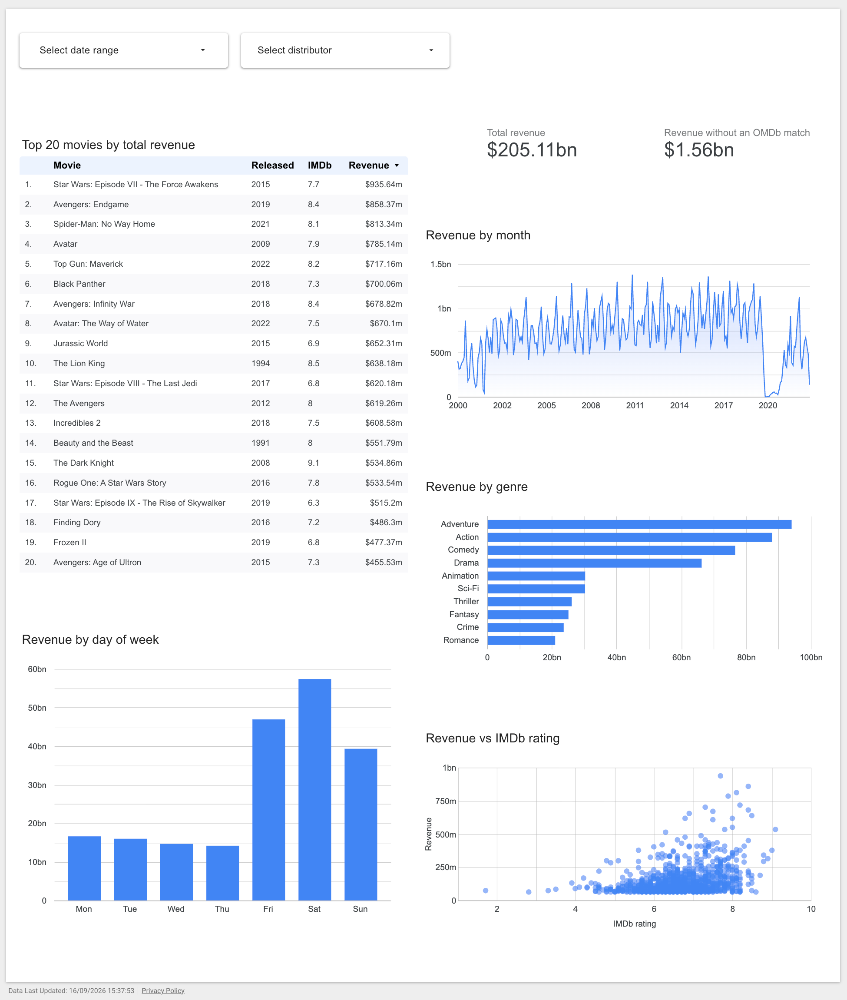

# OMDb Box Office Data Warehouse

Box office data warehouse on Google Cloud Platform: daily box office revenues enriched with OMDb metadata. The result is a ranking [dashboard in Looker Studio](https://datastudio.google.com/reporting/4260f514-691a-4634-a119-6125234cd412).

Stack: Cloud Storage, BigQuery, Dataform, Terraform, Python (uv), Looker Studio.

## Sources

Source data for the data warehouse comes from:

1. CSV file with daily box office revenues (`data/revenues_per_day.csv`, not in the repo)
   - Box Office Mojo data published as GitHub releases by [boxofficemojo-scraper](https://github.com/tjwaterman99/boxofficemojo-scraper). The [latest release](https://github.com/tjwaterman99/boxofficemojo-scraper/releases/latest/download/revenues_per_day.csv.gz) is a newer, bigger file; the numbers in this README and on the dashboard come from a release from March 2023.
   - One row per movie title per day (337 818 rows).
   - Date range: 2000-01-01 to 2023-03-06.
   - Columns: `id`, `date`, `title`, `revenue`, `theaters`, `distributor`.
   - Sample row:

   ```csv
   id,date,title,revenue,theaters,distributor
   8b19ad43-3a7e-b14b-49e9-1f7a0eb1568e,2004-09-20,Sky Captain and the World of Tomorrow,925482,3170,Paramount Pictures
   ```

2. Movie metadata from the [OMDb API](https://www.omdbapi.com/)
   - One request per cleaned title.
   - Free key: 1 000 requests per day, so a full fetch would take 7 days.
   - Paid key (Patreon, 1 USD per month): 100 000 requests per day, the full fetch took 27 minutes.
   - Fields from the response used in the model: `imdbID`, `Title`, `Year`, `Released`, `Rated`, `Runtime`, `Director`, `Country`, `imdbRating`, `BoxOffice`, `Genre`, `Response`.

## Architecture



1. The CSV file is uploaded once to the landing bucket.
2. The fetch script reads from BigQuery the requests without an OMDb response, calls the API and writes the responses to the same bucket.
3. External tables in `raw` read the bucket.
4. Dataform builds `staging`, `intermediate` and `mart`.
5. Looker Studio reads the views in `mart`.

There is no scheduler. Dataform and the fetch script run from the command line (see [How to run](#how-to-run)).

### Infra

Terraform (`terraform/`, state in a GCS backend) creates:
- The required APIs.
- The landing bucket `landing-<random hex>`: no public access, `prevent_destroy`.
- Five datasets (`raw`, `staging`, `intermediate`, `mart`, `assertions`), also with `prevent_destroy`.
- Two external tables in `raw` with explicit schemas (`terraform/schemas/`):
  - `box_office` reads the CSV.
  - `omdb` reads `omdb/*.ndjson`.
  - No deletion protection, because they hold only a schema and the path to the files.

Created by hand: the project and the bucket for the Terraform state.

### Layers

- `raw`: the files as delivered. The CSV has all columns as `STRING`, the OMDb table keeps `request` and `response` as `JSON`.
- `staging`: one model per source, normalized column data types, cleaned title for OMDb lookup.
- `intermediate`: joins both sources. For now one view: the requests that have no OMDb response yet.
- `mart`: the star schema and two views for the dashboard.

Rule for placing a model: if it can be computed from one row of a single source, it is staging. Otherwise it is intermediate.



## OMDb lookups

1. Title cleaning in SQL (`stg_box_office`, function `decode_char_codes`)
   - Character codes: `Les Misu00e9rables` -> `Les Misérables` (48 titles, 44 found after cleaning).
   - Year with no space before it, and everything after it: `Vertigo2018 Re-release` -> `Vertigo` (321 titles, 315 found after cleaning).
   - 6 545 raw titles -> 6 426 requests.
   - The rules are in SQL, not in the fetch script, so a changed rule does not change the raw layer.

2. Requests to fetch
   - A request is identified by the cleaned title.
   - The script fetches only the requests without a response (view `int_omdb_requests_to_fetch`).
   - The view reads the responses through `stg_omdb`, which is also a view, so a new response is visible right after the file lands in the bucket, without `dataform run`.
   - After a rule change, only the titles whose cleaned form changed become new requests. The old responses stay in raw and are no longer joined.
   - A failed request has no response, so the next run fetches it again.

3. Request to OMDb
   - `t=<cleaned title>&type=movie`, without `y=`.
   - With `y=`, OMDb returns a movie only when the year matches exactly, and the screening year is often not the release year. On all 6 426 requests: 80% found with the year of the first screening, 97% without.
   - Cost: a title shared by two movies gets the metadata of one of them. How often: see Result.

4. Response (`raw.omdb`)
   - One row per request: `request` (without the API key), `fetched_at`, `response` as JSON.
   - Success means `Response` is `True`, not HTTP `200`: OMDb returns `200` with `Movie not found!`. Such a response is stored too.
   - Rows are saved in NDJSON files of 100 rows in the Cloud Storage bucket.
   - Sample row (response shortened):

   ```json
   {"request": {"t": "Avatar", "type": "movie"},
    "fetched_at": "2026-09-15T11:27:13+00:00",
    "response": {"Title": "Avatar", "Year": "2009", "Released": "18 Dec 2009",
                 "Genre": "Action, Adventure, Fantasy", "imdbRating": "7.9",
                 "BoxOffice": "$785,221,649", "Response": "True", "...": "..."}}
   ```

5. Result

   | | titles | share of revenue |
   |---|---|---|
   | Raw titles in the file | 6 545 | |
   | Requests after cleaning | 6 426 | |
   | No movie found (`Response: False`) | 165 | 0.76% |
   | Movie found | 6 261 | |
   | Of which a later movie with the same title (screened more than a year before the OMDb release date) | 165 | 0.9% |

   - No movie found, usually because OMDb names it differently: `Fantastic 4: Rise of the Silver Surfer` in the file, `Fantastic Four: Rise of the Silver Surfer` in OMDb. These titles get key `-1` (see [Data model](#data-model)).
   - A later movie with the same title: `Beast`, screened in 2018 and 2022, OMDb returned the 2022 movie.
   - An older movie with the same title (not measured): `The Lion King`, screened in 2003, 2011 and 2019, OMDb returned the 1994 movie.

## Data model



- Fact grain: one row per title and screening day, the same as the source file.
- `revenue` can be summed over days, movies and distributors.
- `theaters_number` is the number of theaters on that day, so it must not be summed over days (average or maximum only).
- Key `-1`: `dim_movie` and `dim_distributor` have one extra row named `(unresolved)`. A fact row with no match (movie not found in OMDb, no distributor in the file) gets this key instead of NULL, so joins do not lose rows.
- Genres go through the bridge table `bridge_movie_genre`, because a movie has several genres. A movie counts in every genre it has, so do not add the genre totals up: the sum is bigger than Total revenue.
- Titles without a movie in OMDb have no genre, so they count in Total revenue on the dashboard, but not in revenue by genre.
- Two views for the dashboard: `rpt_daily_revenue` (fact rows with dimension columns in one place) and `rpt_genre_revenue`.

## Data quality

Assertions run as part of `dataform run`. A failing assertion fails the run.

| assertion | checks |
|---|---|
| `fct_daily_revenue`: `uniqueKey`, `nonNull`, `rowConditions` | `row_id` is unique; keys, `screening_date` and `revenue` are not NULL; `revenue >= 0` |
| `fact_matches_raw` | row count and total revenue of the fact equal the raw file, so the joins with OMDb do not lose or duplicate rows |

## Dashboard



[Dashboard in Looker Studio](https://datastudio.google.com/reporting/4260f514-691a-4634-a119-6125234cd412)

Filters: date range (screening date) and distributor. The distributor filter does not apply to revenue by genre, because `rpt_genre_revenue` has no distributor.

- Total revenue: sum of `revenue`, including the rows without an OMDb match.
- Revenue without an OMDb match: the same sum for `movie_key = -1`.
- Top 20 movies by total revenue: sum of `revenue` per movie, sorted by the sum, with the release year and IMDb rating from OMDb.
- Revenue by month: sum of `revenue` per month of the screening date.
- Revenue by genre: sum of `revenue` per genre from `rpt_genre_revenue`.
- Revenue by day of week: sum of `revenue` per weekday of the screening date.
- Revenue vs IMDb rating: one dot per movie, sum of `revenue` against the IMDb rating from OMDb.

## How to run

The order in which this project was built. It was not re-tested on a fresh project.

1. By hand: a GCP project with billing, a bucket for the Terraform state, `gcloud auth application-default login`, an OMDb API key in `.env` (see [`.env.example`](.env.example)).
2. `terraform apply` in `terraform/` with your `terraform.tfvars` (see [`terraform.tfvars.example`](terraform/terraform.tfvars.example)). The output is the landing bucket name.
3. Download the CSV and upload it to `box_office/` in the landing bucket:

   ```bash
   mkdir -p data
   curl -L https://github.com/tjwaterman99/boxofficemojo-scraper/releases/latest/download/revenues_per_day.csv.gz | gunzip > data/revenues_per_day.csv
   ```
4. `dataform init-creds` and `dataform run` in `dataform/`, so the view for the fetch script exists. An empty `omdb/` prefix is fine: the external table returns no rows.
5. `uv run python src/omdb_box_office_dwh/fetch_movies.py`. An optional number limits the requests, for a smoke test.
6. `dataform run` again: the full model with assertions.

## What's next and why not now

1. Orchestration: Cloud Run Job with Cloud Scheduler for the fetch script and `dataform run`, with a dedicated service account. Not now, because the source is a one-off file and there is nothing to schedule yet.
2. Better OMDb matching. Not now, because the misses and the wrong matches are below 1% of revenue each.
   - The check from [OMDb lookups](#omdb-lookups) (a title screened long before the OMDb release date) as a Dataform model, run on every build.
   - A hand-made list title -> `imdbID` for the titles flagged by that check and for the misses with the biggest revenue. For those titles the script asks OMDb by `i=<imdbID>` instead of the title.
3. Incremental loads. Not at this volume: the whole model rebuilds in seconds, and a daily file would add a few hundred rows. Worth it when a rebuild takes minutes or costs money.
